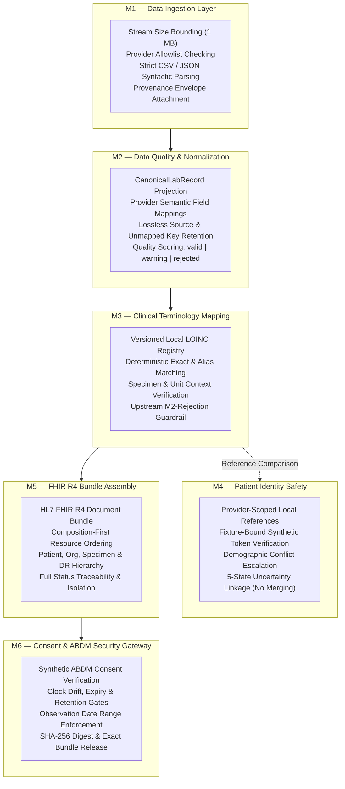
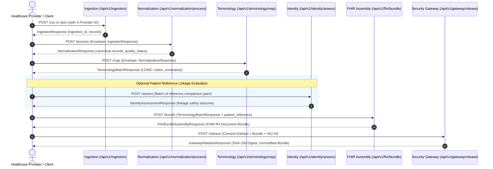

# TN HealthBridge — An Uncertainty-Aware Healthcare Interoperability Framework for ABDM-Aligned Data Exchange

[](pyproject.toml)
[](LICENSE)
[](docs/TESTING.md)

---

## 1. Project Title & Overview

**TN HealthBridge** is an open-source academic research prototype and healthcare interoperability middleware designed to enable heterogeneous, autonomous healthcare providers (e.g., regional hospitals, outpatient centers, clinical diagnostics laboratories) to exchange structured clinical data safely and reliably.

The framework aligns with national digital health interoperability principles—specifically India's **Ayushman Bharat Digital Mission (ABDM)** and **HL7® FHIR® R4**—while introducing explicit uncertainty-aware mechanisms. It treats clinical data quality, terminology ambiguity, patient identity resolution, and consent enforcement as first-class uncertainty states, actively preventing dangerous silent errors, lossy data conversions, unsafe automated identity merges, and unconsented clinical data leakage.

---

## 2. Research Motivation & Problem Statement

In modern cross-institutional healthcare data exchange, participants face five core structural hazards:

1. **Heterogeneity vs. Forced Centralization:** Conventional approaches often mandate that all participants conform to a single monolithic database or overhaul legacy Hospital Information Systems (HIS) and Laboratory Information Systems (LIS). This infringes on provider data sovereignty and introduces catastrophic single points of failure.
2. **Clinical Terminology Conflation:** Naive automated terminology translation frequently applies loose fuzzy string matching or performs unvalidated unit conversions across incompatible physical properties (e.g., conflating mass concentration in $\text{mg/dL}$ with molar substance concentration in $\text{mmol/L}$), creating severe diagnostic and therapeutic risks.
3. **Identity Resolution Hazards:** Local hospital identifiers (such as Medical Record Numbers) routinely collide across independent healthcare facilities. When record linkage engines rely on simplistic demographic matching without cryptographic or explicit trust-binding, unrelated patient records are erroneously merged, permanently corrupting clinical histories.
4. **FHIR R4 Impedance Mismatch:** Translating raw laboratory data into HL7 FHIR R4 documents frequently results in structural non-conformance, fabricated provenance, or missing parent-child relationship links between `Composition`, `DiagnosticReport`, and `Observation` resources.
5. **Consent Bounding & Release Overreach:** Automated gateways often lack fine-grained, fail-closed temporal enforcement. When clinical observations fall outside the patient's authorized consent date range or when consent artefacts have expired, legacy systems frequently release the data anyway or attempt lossy, ad-hoc payload pruning.

---

## 3. Project Objectives

- **Decentralized Interoperability:** Enable secure clinical data exchange across independent healthcare providers without introducing a central patient database.
- **Explainable Data Quality:** Project heterogeneous vendor records into a standardized canonical laboratory schema while losslessly preserving all original fields and flagging quality issues (`valid`, `warning`, `rejected`).
- **Deterministic Terminology Mapping:** Standardize clinical test names to authoritative concepts (LOINC) using strict contextual constraints (biological specimen and unit verification) and an explicit human review escalation pathway.
- **Uncertainty-Aware Patient Identity Safety:** Scope local identifiers strictly to provider contexts, require authorized synthetic fixture trust-binding for positive linkage, and eliminate hazardous automated record merging.
- **Standards-Compliant FHIR R4 Assembly:** Assemble compliant FHIR R4 Document Bundles with `Composition` as the mandatory first resource, complete patient and organization provenance, and full status code traceability.
- **Consent-Bound Security Gateway:** Enforce ABDM-aligned consent validation across six security gates—evaluating clock drift, lifecycle status, expiry deadlines, retention bounds, caller authorization, and observation date limits—with plain SHA-256 integrity digests.
- **Reproducible Academic Prototype:** Maintain an auditable, well-tested Python codebase with 100% passing automated tests across all implemented modules.

---

## 4. What TN HealthBridge Does and Does Not Do

### What TN HealthBridge Does:
- **M1 Ingestion:** Ingests tabular CSV uploads and structured JSON payloads from authorized healthcare providers with strict 1 MB stream bounding.
- **M2 Normalization:** Projects heterogeneous observation keys into a canonical laboratory schema (`CanonicalLabRecord`), normalizing datatypes and ISO-8601 timestamps without fabricating artificial midnight times.
- **M3 Terminology:** Resolves test names deterministically against a versioned local LOINC registry, enforcing specimen and unit compatibility, while withholding standard codes from upstream M2-rejected records.
- **M4 Identity Safety:** Scopes patient references to their originating provider (e.g. `HOSPITAL_A:SYN001` vs `HOSPITAL_B:SYN001`) and assesses linkage safety using a 5-state uncertainty engine (`same_identity`, `different_identity`, `possible_match`, `unresolved`, `review_required`).
- **M5 FHIR Assembly:** Packages validated clinical records into standardized HL7 FHIR R4 Document Bundles (`Bundle.type = "document"`), strictly positioning `Composition` first, followed by `Patient`, `Organization`, `Specimen`, `DiagnosticReport`, and `Observation`.
- **M6 Security Gateway:** Enforces synthetic ABDM-aligned electronic consent validation, verifying temporal authorization, HI-type eligibility (`DiagnosticReport`), HIU/HIP actors, and observation date bounding before release.
- **Tamper-Evident Digest:** Computes deterministic plain SHA-256 integrity digests over canonical release metadata and the exact unmodified FHIR bundle.
- **Zero In-Memory Spooling:** Processes records purely in-memory with zero disk persistence of clinical payloads.

### What TN HealthBridge Does NOT Do:
- **No Central Clinical Database:** It does not persist patient medical records, clinical observations, or identity mappings to a database (SQL, NoSQL, or local SQLite).
- **No Automated Record Merging:** It evaluates linkage safety between references; it never merges, overwrites, or combines patient charts.
- **No Fuzzy Equivalence:** It never uses phonetic algorithms, edit-distance heuristics, or probabilistic embeddings to guess clinical concepts.
- **No Automatic Unit Conversion:** It never guesses mathematical formulas to convert between mass concentrations and molar units.
- **No Data Fabrication:** It never fabricates missing observation timestamps or time zones.
- **No Partial or Pruned Releases:** If any observation falls outside the consented date window or any gate fails, M6 rejects the entire release fail-closed without modifying the bundle.
- **No Real ABHA / ABDM Network Connection:** It is an academic research simulation and does not connect to live Government of India NHA/ABDM production gateways or live ABHA identity servers.
- **No Caller Override of Security Settings:** Client request fields cannot enable synthetic test signatures when server-side configuration disables them or when running in production.

---

## 5. M1–M6 Module Overview



Detailed specifications for each module are documented in:
- [M1 Data Ingestion](docs/modules/M1_DATA_INGESTION.md)
- [M2 Data Quality & Normalization](docs/modules/M2_DATA_NORMALIZATION.md)
- [M3 Clinical Terminology Mapping](docs/modules/M3_TERMINOLOGY_MAPPING.md)
- [M4 Patient Identity Safety](docs/modules/M4_PATIENT_IDENTITY_SAFETY.md)
- [M5 FHIR Bundle Assembly](app/services/fhir_service.py)
- [M6 Consent & ABDM Security Gateway](app/services/gateway_service.py)

---

## 6. Architecture & Data Flow

Callers invoke modular HTTP endpoints in sequence. Output envelopes from upstream stages serve as validated inputs to downstream stages:



For in-depth architectural diagrams and trust boundaries, see:
- [System Overview](docs/architecture/SYSTEM_OVERVIEW.md)
- [End-to-End Data Flow](docs/architecture/DATA_FLOW.md)
- [Module Dependencies](docs/architecture/MODULE_DEPENDENCIES.md)

---

## 7. Technology Stack

- **Language & Runtime:** Python 3.11 / 3.12 / 3.14
- **Web Framework:** [FastAPI](https://fastapi.tiangolo.com/) (High-performance, async REST API)
- **ASGI Server:** [Uvicorn](https://www.uvicorn.org/) (Standard async worker implementation)
- **Data Validation & Schemas:** [Pydantic v2](https://docs.pydantic.dev/) and `pydantic-settings`
- **Testing & Quality Assurance:** [pytest](https://pytest.org/), [httpx](https://www.python-httpx.org/), [pytest-cov](https://pytest-cov.readthedocs.io/)
- **Standard Vocabularies:** LOINC (Logical Observation Identifiers Names and Codes) v2.76 compatibility profile
- **Healthcare Data Standard:** HL7® FHIR® R4 (Document Bundle Specification)
- **Security & Integrity:** Cryptographic SHA-256 Integrity Digest, ABDM Consent Artefact Schema v0.2.0 simulation

---

## 8. Supported Endpoints & API Reference

All application endpoints are served under the `/api/v1` prefix (configurable via `API_V1_PREFIX`):

| Module | HTTP Method | Path | Content-Type | Summary / Responsibility |
| :--- | :---: | :--- | :--- | :--- |
| **System** | `GET` | `/health` | `application/json` | Verifies service availability and lists all 6 active modules. |
| **M1** | `POST` | `/api/v1/ingestion/csv` | `multipart/form-data` | Ingests CSV files, bounding stream size to 1 MB (`X-Provider-ID` header or `provider_id` form field). |
| **M1** | `POST` | `/api/v1/ingestion/json` | `application/json` | Ingests structured JSON clinical record batches for registered providers. |
| **M2** | `POST` | `/api/v1/normalization/process` | `application/json` | Projects M1 envelope into `CanonicalLabRecord` schema and scores quality. |
| **M3** | `POST` | `/api/v1/terminology/map` | `application/json` | Deterministically maps normalized tests to LOINC concepts with context checks. |
| **M4** | `POST` | `/api/v1/identity/assess` | `application/json` | Assesses patient identity linkage safety across provider-scoped references. |
| **M5** | `POST` | `/api/v1/fhir/bundle` | `application/json` | Assembles validated records into an HL7 FHIR R4 Document Bundle. |
| **M6** | `POST` | `/api/v1/gateway/release` | `application/json` | Validates synthetic ABDM consent and releases the unmodified bundle with SHA-256 digest. |

---

## 9. Installation and Setup

### 9.1 Prerequisites
- Python 3.11, 3.12, or 3.14 installed on your system.
- Git for source control management.

### 9.2 Clone Repository
```bash
git clone https://github.com/Priyadharshan-SC/TN-HEALTHBRIDGE.git
cd TN-HEALTHBRIDGE
```

### 9.3 Create and Activate Virtual Environment

**On Windows (PowerShell):**
```powershell
python -m venv .venv
.\.venv\Scripts\Activate.ps1
```

**On Linux / macOS (Bash / Zsh):**
```bash
python3 -m venv .venv
source .venv/bin/activate
```

### 9.4 Install Dependencies

Install core runtime dependencies:
```bash
pip install -r requirements.txt
```

Install development and test dependencies:
```bash
pip install -r requirements-dev.txt
```

---

## 10. Configuration & Environment Variables

Copy the provided environment template to `.env`:
```bash
cp .env.example .env
```

Configuration defaults are managed centrally in `app/core/config.py`:

| Variable | Default Value | Description |
| :--- | :--- | :--- |
| `ENVIRONMENT` | `development` | Operating environment (`development`, `test`, `production`). |
| `PROJECT_NAME` | `TN HealthBridge` | Application title reported in logs and OpenAPI docs. |
| `API_V1_PREFIX` | `/api/v1` | URL prefix for all module API routes. |
| `MAX_UPLOAD_SIZE_BYTES`| `1048576` | Hard 1 MB stream cap to prevent memory exhaustion attacks. |
| `MAX_RECORD_COUNT` | `1000` | Maximum allowable clinical records per batch. |
| `ALLOWED_PROVIDERS` | `HOSPITAL_A,HOSPITAL_B,LAB_C` | Allowlist of authorized healthcare provider identifiers. |
| `SYNTHETIC_IDENTITY_REGISTRY_PATH` | `data/identity/synthetic_identity_registry.json` | Authoritative synthetic identity test fixture path. |
| `ALLOW_TEST_SIGNATURES` | `false` | Strictly disables synthetic signatures (`TEST_SIG_*`) by default; forbidden in production. |

---

## 11. Running the Application Locally

Start the local Uvicorn development server:

```bash
uvicorn app.main:app --reload --host 127.0.0.1 --port 8000
```

### Accessing Interactive OpenAPI Documentation
Once started, navigate to your browser:
- **Interactive Swagger UI:** [http://127.0.0.1:8000/docs](http://127.0.0.1:8000/docs)
- **ReDoc UI:** [http://127.0.0.1:8000/redoc](http://127.0.0.1:8000/redoc)
- **Raw OpenAPI Specification:** [http://127.0.0.1:8000/openapi.json](http://127.0.0.1:8000/openapi.json)

---

## 12. Running Automated Tests

Run the complete regression test suite using `pytest`:

```bash
python -m pytest -v
```

### Verified Test Suite Baseline
The current test suite consists of **262 automated unit and integration tests, 100% passing**:

```text
======================= 262 passed, 1 warning in 1.66s =======================
```

To run individual module test suites:
```bash
python -m pytest tests/test_ingestion.py -v       # 28 passing tests (M1 Ingestion)
python -m pytest tests/test_normalization.py -v   # 34 passing tests (M2 Normalization & QA)
python -m pytest tests/test_terminology.py -v     # 34 passing tests (M3 Terminology Mapping)
python -m pytest tests/test_identity.py -v        # 66 passing tests (M4 Patient Identity Safety)
python -m pytest tests/test_fhir.py -v            # 41 passing tests (M5 FHIR R4 Bundle Assembly)
python -m pytest tests/test_gateway.py -v         # 59 passing tests (M6 Consent & Security Gateway)
```

See [Testing Guide](docs/TESTING.md) for coverage analysis and test conventions.

---

## 13. End-to-End API Usage Example (Synthetic Data)

This walkthrough demonstrates the complete pipeline from raw CSV ingestion through to consent-bound data release.

### Step 1: Health Check
```bash
curl -X GET http://127.0.0.1:8000/health
```
*Response:*
```json
{
  "status": "healthy",
  "service": "TN HealthBridge",
  "module": "M1_DATA_INGESTION",
  "modules": [
    "M1_DATA_INGESTION",
    "M2_DATA_NORMALIZATION",
    "M3_CLINICAL_TERMINOLOGY_MAPPING",
    "M4_PATIENT_IDENTITY_SAFETY",
    "M5_FHIR_BUNDLE_ASSEMBLY",
    "M6_CONSENT_SECURITY_GATEWAY"
  ]
}
```

### Step 2: Ingest CSV Clinical Records (M1)
```bash
curl -X POST http://127.0.0.1:8000/api/v1/ingestion/csv \
  -H "X-Provider-ID: HOSPITAL_A" \
  -F "file=@data/samples/hospital_a.csv"
```

### Step 3: Normalize & Score Clinical Quality (M2)
Pass the JSON response from M1 directly into M2:
```bash
curl -X POST http://127.0.0.1:8000/api/v1/normalization/process \
  -H "Content-Type: application/json" \
  -d '<m1_ingestion_response_json>'
```

### Step 4: Map to LOINC Standard Concepts (M3)
Pass the JSON response from M2 directly into M3:
```bash
curl -X POST http://127.0.0.1:8000/api/v1/terminology/map \
  -H "Content-Type: application/json" \
  -d '<m2_normalization_response_json>'
```

### Step 5: Assess Patient Identity Linkage Safety (M4)
Evaluate whether two provider-local references represent the same individual:
```bash
curl -X POST http://127.0.0.1:8000/api/v1/identity/assess \
  -H "Content-Type: application/json" \
  -d '{
    "comparisons": [
      {
        "comparison_id": "CMP-DEMO-001",
        "record_a": {
          "source_provider_id": "HOSPITAL_A",
          "local_patient_id": "SYN001"
        },
        "record_b": {
          "source_provider_id": "HOSPITAL_B",
          "local_patient_id": "SYN001"
        }
      }
    ]
  }'
```
*Outcome:* Returns status `"unresolved"` with reason code `"SAME_LOCAL_ID_DIFFERENT_PROVIDERS"`, actively preventing an unsafe automated merge.

### Step 6: Assemble FHIR R4 Document Bundle (M5)
Wrap M3's batch response to assemble an HL7 FHIR R4 document bundle:
```bash
curl -X POST http://127.0.0.1:8000/api/v1/fhir/bundle \
  -H "Content-Type: application/json" \
  -d '{
    "batch": <m3_terminology_response_json>,
    "patient_reference": "SYN001"
  }'
```

### Step 7: Consent Validation & Secure Release (M6)
Submit the assembled bundle alongside the synthetic ABDM consent artefact to the gateway:
```bash
curl -X POST http://127.0.0.1:8000/api/v1/gateway/release \
  -H "Content-Type: application/json" \
  -d '{
    "consent": {
      "consent_id": "CONSENT-SYNTH-001",
      "status": "GRANTED",
      "created_at": "2026-10-27T10:00:00Z",
      "patient": { "id": "SYN001" },
      "purpose": { "code": "CAREMGT", "text": "Care Management" },
      "hip": { "id": "HOSPITAL_A" },
      "hiu": { "id": "HIU_001" },
      "permission": {
        "access_mode": "VIEW",
        "date_range": {
          "from_date": "2026-01-01T00:00:00Z",
          "to_date": "2026-12-31T23:59:59Z"
        },
        "data_erase_at": "2030-01-01T00:00:00Z"
      },
      "consent_expiry": "2028-01-01T00:00:00Z",
      "hi_types": ["DiagnosticReport"],
      "signature": "TEST_SIG_CONSENT-SYNTH-001"
    },
    "bundle": <m5_bundle_json>,
    "hiu_id": "HIU_001",
    "allow_test_signatures": true
  }'
```
*Outcome:* Returns `GatewayReleaseResponse` with status `"released"`, the exact unmodified FHIR bundle, and a plain SHA-256 integrity digest.

---

## 14. Repository Structure

```text
TN-HEALTHBRIDGE/
├── README.md                      # Primary project overview, architecture, & setup
├── LICENSE                        # Academic prototype licensing notice & terms
├── SECURITY.md                    # Vulnerability reporting & synthetic data notice
├── .gitignore                     # Git exclusion rules for Python, virtualenvs, & IDEs
├── .gitattributes                 # Cross-platform line ending configurations
├── requirements.txt               # Production runtime dependencies
├── requirements-dev.txt           # Testing and development dependencies
├── pyproject.toml                 # Packaging metadata and pytest configuration
├── .env.example                   # Environment variable template
│
├── app/                           # Core application package
│   ├── __init__.py
│   ├── main.py                    # Application factory, lifespan, & exception handlers
│   ├── api/                       # API route controllers
│   │   ├── __init__.py
│   │   ├── ingestion.py           # M1 endpoints: /api/v1/ingestion/csv & /json
│   │   ├── normalization.py       # M2 endpoint: /api/v1/normalization/process
│   │   ├── terminology.py         # M3 endpoint: /api/v1/terminology/map
│   │   ├── identity.py            # M4 endpoint: /api/v1/identity/assess
│   │   ├── fhir.py                # M5 endpoint: /api/v1/fhir/bundle
│   │   └── gateway.py             # M6 endpoint: /api/v1/gateway/release
│   ├── core/                      # Configuration & domain error definitions
│   │   ├── __init__.py
│   │   ├── config.py              # Base Settings model & provider allowlist
│   │   ├── errors.py              # Domain exceptions & error codes
│   │   ├── normalization_config.py# Provider field mappings & alias policies
│   │   ├── terminology_config.py  # Terminology registry loader & validator
│   │   └── identity_config.py     # Authoritative synthetic identity loader
│   ├── schemas/                   # Strongly-typed Pydantic contract models
│   │   ├── __init__.py
│   │   ├── ingestion.py           # Ingestion envelopes & record schemas
│   │   ├── normalization.py       # CanonicalLabRecord & normalization responses
│   │   ├── terminology.py         # Terminology mapping requests & responses
│   │   ├── identity.py            # Identity comparison requests & responses
│   │   ├── fhir.py                # FHIR R4 Bundle, Composition, DR, Observation
│   │   └── gateway.py             # ABDM consent artefacts & release envelopes
│   └── services/                  # Stateless domain logic engines
│       ├── __init__.py
│       ├── ingestion_service.py   # Stream parser & allowlist validator
│       ├── normalization_service.py# Schema mapper, type coerces, & QA scoring
│       ├── terminology_service.py # LOINC matching & context constraint evaluator
│       ├── identity_service.py    # Provider scoping, trust binding, & linkage safety
│       ├── fhir_service.py        # FHIR R4 Document Bundle assembler
│       └── gateway_service.py     # ABDM 6-gate consent validator & release engine
│
├── data/                          # Authoritative configuration fixtures & samples
│   ├── identity/                  # Synthetic identity subject & linkage fixture registries
│   │   ├── synthetic_identity_registry.json
│   │   └── synthetic_linkage_fixtures.json
│   ├── samples/                   # Synthetic test payloads
│   │   ├── hospital_a.csv
│   │   └── hospital_b.json
│   └── terminology/               # Versioned local LOINC mapping registry
│       └── default_registry.json
│
├── tests/                         # Automated pytest test suites (262 tests)
│   ├── __init__.py
│   ├── test_ingestion.py          # 28 tests for M1 ingestion
│   ├── test_normalization.py      # 34 tests for M2 normalization & QA
│   ├── test_terminology.py        # 34 tests for M3 terminology & context rules
│   ├── test_identity.py           # 66 tests for M4 identity safety & linkage
│   ├── test_fhir.py               # 41 tests for M5 FHIR R4 bundle assembly
│   └── test_gateway.py            # 59 tests for M6 consent & security gateway
│
└── docs/                          # Comprehensive technical documentation
    ├── architecture/
    │   ├── SYSTEM_OVERVIEW.md     # Architectural patterns & trust boundaries
    │   ├── DATA_FLOW.md           # End-to-end data lifecycle & sequence flows
    │   └── MODULE_DEPENDENCIES.md # Inter-module coupling & schema contracts
    ├── modules/
    │   ├── M1_DATA_INGESTION.md   # M1 functional specification
    │   ├── M2_DATA_NORMALIZATION.md # M2 functional specification
    │   ├── M3_TERMINOLOGY_MAPPING.md # M3 functional specification
    │   └── M4_PATIENT_IDENTITY_SAFETY.md # M4 functional specification
    ├── api/
    │   └── API_REFERENCE.md       # Complete REST API reference manual
    ├── security/
    │   └── SECURITY_AND_PRIVACY.md# Privacy policies & threat boundaries
    ├── research/
    │   └── SCOPE_AND_LIMITATIONS.md# Research scope & planned roadmap
    ├── DEVELOPMENT.md             # Developer environment setup guide
    ├── TESTING.md                 # Testing guide & verification matrix
    └── CHANGELOG.md               # Version history and release notes
```

---

## 15. Security, Privacy & Research Limitations

- **Academic Prototype Only:** TN HealthBridge is an academic research prototype. It is not approved as medical device software or a certified production Health Repository (HIP/HIU).
- **Synthetic Data Exclusively:** Do not ingest real protected health information (PHI) into this prototype without enterprise security hardening.
- **Server-Controlled Test Signatures:** In non-test environments or production, synthetic test signatures (`TEST_SIG_*`) are unconditionally forbidden. Client requests cannot override a disabled server setting.
- **Privacy-Safe Error Sanitization:** Domain error messages emitted by API endpoints are sanitized to prevent disclosing patient identifiers, clinical observations, or unconsented timestamps.
- **Fail-Closed Release Boundary:** If any observation falls outside the consented date window or lacks a timestamp, M6 rejects the entire release without mutating or partially releasing the bundle.
- **Provider Allowlist Scope:** In the current release, provider identity is established via allowlist verification of caller-supplied IDs. Future production deployments must incorporate mutual TLS (mTLS).
- See [Security and Privacy](docs/security/SECURITY_AND_PRIVACY.md) and [Scope and Limitations](docs/research/SCOPE_AND_LIMITATIONS.md) for further details.

---

## 16. Current Implementation Status & Roadmap

| Module | Name | Status | Verified Tests |
| :--- | :--- | :---: | :---: |
| **M1** | Data Ingestion Gateway | **Implemented** | 28 |
| **M2** | Data Quality and Normalization | **Implemented** | 34 |
| **M3** | Clinical Terminology Mapping | **Implemented** | 34 |
| **M4** | Patient Identity Safety and Linkage | **Implemented** | 66 |
| **M5** | FHIR R4 Bundle Assembly | **Implemented** | 41 |
| **M6** | Consent & ABDM Security Gateway | **Implemented** | 59 |
| **Total** | **Active Test Baseline** | **100% Passing** | **262** |
| **M7** | Inter-Provider Secure Delivery (mTLS) | *Planned (Not Implemented)* | 0 |
| **M8** | Federated Audit & Compliance | *Planned (Not Implemented)* | 0 |

---

## 17. Contribution Guidelines

We welcome research contributions that enhance clinical data interoperability, expand standard LOINC/SNOMED CT mapping registries, and strengthen identity and consent uncertainty safety.

1. Fork the repository and create a feature branch (`git checkout -b feature/clinical-concept-expansion`).
2. Adhere to core architectural rules:
   - **Do not introduce a database** or persistent clinical storage.
   - **Do not execute automatic patient record merges**.
   - **Do not mutate or prune FHIR bundles** upon consent rejection.
   - **Use synthetic data exclusively** for test fixtures.
3. Verify that all 262 existing tests pass:
   ```bash
   python -m pytest -v
   ```
4. Open a Pull Request using the provided Pull Request Template.

---

## 18. Licensing

This project is currently distributed as an academic research prototype. Please refer to [LICENSE](LICENSE) for licensing status, intellectual property notices, and guidance for repository maintainers regarding open-source license selection (e.g., Apache 2.0 / MIT).
